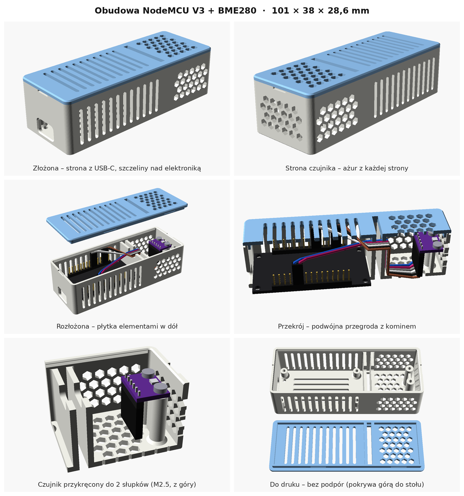

# Obudowa: NodeMCU V3 (ESP8266, CH340C, USB-C) + GY-BME/P280

Parametryczna obudowa w OpenSCAD. Ma dwie komory oddzielone litą przegrodą:

- **elektronika**: podłużne szczeliny w ścianach, w pokrywie i w dnie, otwór na USB-C w ścianie czołowej,
- **czujnik**: ażur (plaster miodu albo okrągłe oczka) w obu ścianach bocznych, w ścianie końcowej, w pokrywie i w dnie.

Wymiary zewnętrzne: **101 × 38 × 28,6 mm**. Obie części to razem ok. 26 cm³ materiału, czyli do ok. 30 g PLA.

## Pliki

| plik | co to jest |
|---|---|
| `obudowa.scad` | model parametryczny; wszystkie wymiary są na górze pliku i w panelu Customizer |
| `stl/obudowa_podstawa.stl` | podstawa ułożona do druku (dnem do stołu) |
| `stl/obudowa_pokrywa.stl` | pokrywa ułożona do druku (górą do stołu) |
| `img/` | rendery |

W `obudowa.scad` zmienna `part` wybiera, co się wyświetla: `assembly`, `exploded`, `section`,
`base`, `lid` albo `print`. STL robisz tak: ustaw `part`, naciśnij **F6**, potem **F7**.
Pełny render (F6) trwa kilkanaście sekund. Podgląd F5 przy tylu otworach czasem pokazuje
artefakty, a F6 zawsze liczy poprawnie.

## Najważniejsze założenia (sprawdź przed drukiem)

1. **NodeMCU leży elementami w dół** (ESP-12 i USB-C od spodu), pinami i kablami do góry,
   tak jak na zdjęciach. Stoi na 4 dystansach 6 mm, pod otworami w rozstawie 52 × 25 mm.
2. **USB-C**: otwór 13 × 7,5 mm mieści obudowę typowego wtyku. Jego środek leży
   1,6 mm pod spodem laminatu (`usb_z`), bo gniazdo SMD wysokości ok. 3,2 mm jest przylutowane od spodu.
   Jeśli wtyk Twojego kabla jest grubszy, zwiększ `usb_w` i `usb_h`.
3. **Nad laminatem jest 17 mm miejsca** (`above_clear`) na goldpiny, wtyczki dupont i zagięte kable.
   Jeśli pokrywa naciska na kable, zwiększ ten parametr.
4. **Czujnik jest przykręcony** dwoma wkrętami do dwóch słupków (18,5 mm) przy ażurowej ścianie końcowej.
   Płytka leży poziomo, układem BME280 do góry, ok. 3 mm pod ażurową pokrywą. Wtyczka 1×6 zwisa w dół.
   Wkręca się z góry przy zdjętej pokrywie, bez nakrętek. **Zmierz rozstaw otworów w czujniku**
   (`sens_hole_dx`, domyślnie 10,7 mm, ustalone ze zdjęcia). Moduły GY-BME280 mają płytkę ok. 15,5 × 11,6 mm
   i otwory Ø 3–3,5 mm, ale rozstawu sklepy nie podają.
   Dawna wersja (wtyczka w kołysce + docisk pokrywą) jest dostępna jako `sensor_mount = "cradle"`.
5. **Przegroda** jest domyślnie podwójna. Między ściankami jest 3 mm szczeliny powietrznej,
   otwartej w dnie i w pokrywie, więc działa jak komin i ciepło z ESP uchodzi do góry.
   `therm_gap = 0` daje zwykłą pojedynczą litą ściankę, a obudowa skraca się o 5 mm.

## Druk

- PLA wystarczy do pomieszczeń; w słońcu lub przy grzejniku użyj PETG albo ASA.
- Warstwa 0,2 mm, 3 obrysy, wypełnienie 15–20 %, **bez podpór**. Oczka są sześciokątami
  „ostrzem do góry”, a rowki zatrzasku mają ścianki pod 45°, więc nie potrzebują podpór.
- Pokrywa trzyma się na kołnierzu i 4 ząbkach zatrzasku. Jeśli wchodzi za ciasno, zwiększ `fit` (np. 0.3)
  albo zmniejsz `snap` (np. 0.3). Przy obu końcach są wcięcia do podważenia pokrywy.

## Montaż

1. Przykręć NodeMCU 4 wkrętami **M2.5 × 6** samogwintującymi (`pilot_d = 2.2`).
   Pod M3 ustaw `pilot_d = 2.6`. Jeśli nie masz wkrętów, ustaw `board_fix = "peg"`:
   wtedy na dystansach są kołki, a pokrywa ma 4 dociski, które trzymają płytkę.
2. Nałóż wtyczkę na piny czujnika. Połóż czujnik na słupkach układem BME280 do góry, pinami w stronę
   przegrody, i przykręć go 2 wkrętami **M2.5 × 6** (`sens_pilot_d = 2.2`; pod M3 ustaw 2.6).
3. Poprowadź 6 przewodów spod wtyczki po dnie do przegrody, w górę i przez wycięcie u góry przegrody,
   a potem podłącz je do pinów NodeMCU.
4. Przepust zatkaj kawałkiem pianki, plasteliny albo kroplą kleju na gorąco,
   żeby ciepłe powietrze nie przechodziło do komory czujnika.
5. Zatrzaśnij pokrywę. Przez otworki w dnie można spinaczem wcisnąć RST i FLASH.

## Żeby odczyt temperatury był dokładny

- Nie ustawiaj obudowy tak, żeby komora czujnika była **nad** elektroniką, bo ciepło idzie do góry.
  Przy montażu pionowym czujnik ma być na dole.
- Małe gumowe nóżki pod spodem dają szczelinom w dnie i kominowi dopływ powietrza.
- W ESPHome odczyt co 60 s wystarczy (`update_interval: 60s`). BME280 pracuje wtedy w trybie wymuszonym
  i prawie się nie grzeje. Ewentualną stałą odchyłkę skoryguj filtrem `offset` po porównaniu z termometrem.
